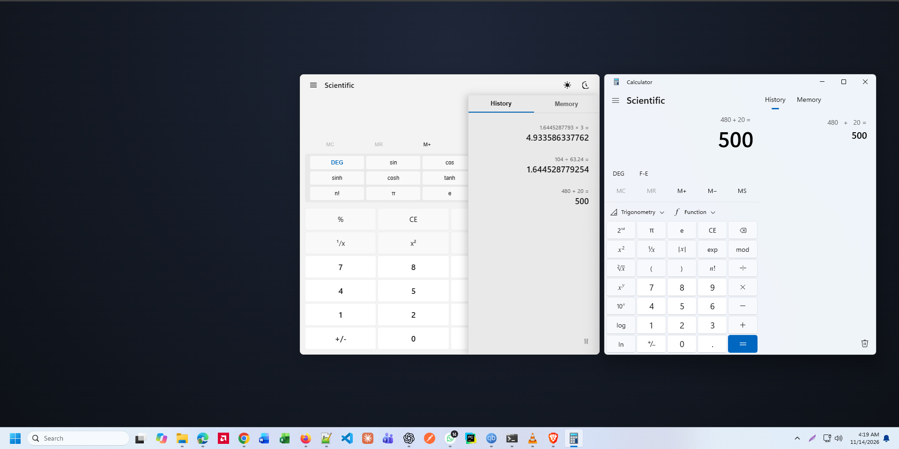

# Windows 11 Fluent Calculator (Reconstructed via REA)

[](LICENSE)
[](package.json)
[](test/calc-engine.test.js)

A modern, high-precision Calculator application reconstructed from the official **Microsoft Windows Calculator** (`Microsoft.WindowsCalculator`) using **Reverse Engineer Anything (REA)**.

<div align="center">
  <br />
  
  <p><em>Figure: Native Windows 11 Calculator (left) vs. REA Reconstructed Fluent Calculator (right)</em></p>
  <br />
</div>

---

## 🔍 How REA Was Used to Reverse Engineer Windows Calculator

Using the REA CLI and inspection tools on the system:

1. **Discovery & Location Identification:**
   * **App Package Location:** `C:\Program Files\WindowsApps\Microsoft.WindowsCalculator_11.2607.0.0_x64__8wekyb3d8bbwe`
   * **System Stub:** `C:\Windows\System32\calc.exe`
   * **Key Components Found:**
     * `CalculatorApp.exe` (x64 PE launcher shim)
     * `CalcViewModel.dll` (WinRT In-Process Server implementing calculation logic)
     * `CalculatorApp.ViewModel.winmd` (Metadata definitions for ViewModels, Commands, Enums)
     * `AppxManifest.xml` (Declaration of activatable classes and extensions)

2. **Artifact & Header Analysis (`rea inspect-artifact` & `rea inspect-pe-imports`):**
   * Recovered PE architecture: `PE32+ amd64` (64-bit).
   * `CalculatorApp.exe` imports `CalculatorApp.dll` with shim entrypoint `RHBinder__ShimExeMain`.
   * Recovered `NETNATIVEBUILDINFO` embedded resource showing compilation with the .NET Native toolchain (`ilc.exe`, `rhbind.exe`) and WinUI controls (`Microsoft.UI.Xaml`).

3. **Managed CLI Metadata & ViewModel Extraction (`rea inspect-managed-artifact`):**
   * Extracted complete class definitions:
     * `CalculatorApp.ViewModel.StandardCalculatorViewModel`
     * `CalculatorApp.ViewModel.HistoryViewModel` & `CalcManagerHistoryItem`
     * `CalculatorApp.ViewModel.MemoryItemViewModel`
     * `CalculatorApp.ViewModel.Snapshot.UnaryCommand`
     * `CalculatorApp.ViewModel.Snapshot.BinaryCommand`
     * `CalculatorApp.ViewModel.Snapshot.OperandCommand`
     * `NumbersAndOperatorsEnum` (Operations: `Add`, `Subtract`, `Multiply`, `Divide`, `Invert`, `Sqrt`, `Power2`, `Cube`, `CubeRoot`, `Percent`, `Negate`, `Factorial`, `LogBase10`, `LogBaseE`, `Sin`, `Cos`, `Tan`, `Sinh`, `Cosh`, `Tanh`, etc.)

---

## 🚀 Features of the Reconstructed Calculator

- **Fluent Design System:**
  - Mica/Acrylic glass aesthetic with dark and light theme switching.
  - Authentic Windows 11 Calculator layout, fonts, and responsive keypads.
- **Two Calculator Modes:**
  - **Standard Mode:** Immediate execution chaining (e.g., `2 + 3 × 4 = 20`), standard memory bar.
  - **Scientific Mode:** Operator precedence (BODMAS/PEMDAS, e.g., `2 + 3 × 4 = 14`), trigonometry (`sin`, `cos`, `tan`), logarithms (`log`, `ln`), powers (`x^y`, `10^x`, `e^x`), and factorials (`n!`).
- **Interactive Side Drawer (History & Memory):**
  - **History Tab:** Records past equations and answers. Click any historical entry to load it into the primary display.
  - **Memory Tab:** Stores numbers with dedicated `MC`, `MR`, `M+`, `M-`, `MS` controls and drawer management.
- **Full Keyboard Shortcuts:**
  - Numpad, `Enter` / `=` for calculation, `Escape` for Clear (C), `Delete` for Clear Entry (CE), `Backspace` for single-digit deletion, operators `+`, `-`, `*`, `/`, `%`.

---

## 📁 Project Structure

```text
├── index.html                 # Windows 11 Fluent UI frontend
├── style.css                  # Fluent Design tokens, Mica & Acrylic themes
├── REA.png                    # Side-by-side comparison screenshot
├── src/
│   ├── calc-engine.js         # Core calculation engine mirroring CalcViewModel.dll
│   └── app.js                 # UI & event controller with keyboard listeners
├── test/
│   └── calc-engine.test.js    # Automated test suite (5/5 passing)
├── cli.js                     # Terminal CLI & interactive REPL
├── server.js                  # Zero-dependency local Node.js HTTP server
├── package.json
└── README.md
```

---

## 💻 Running the Application

### 1. Clone the Repository
```bash
git clone https://github.com/YOUR_USERNAME/rea-windows-calculator.git
cd rea-windows-calculator
```

### 2. Option A: Direct in Any Browser
Simply open `index.html` directly in Microsoft Edge, Google Chrome, or Firefox.

### 3. Option B: Run Local Node.js Server
```bash
npm start
```
Then visit `http://localhost:3000`.

### 4. Option C: Terminal CLI Mode
Evaluate expressions right from the command line:
```bash
node cli.js "120 * 4 + 20"
# Output: Result: 500
```
Or run interactively:
```bash
node cli.js
```

### 5. Option D: Run Automated Unit Tests
```bash
npm test
```
Runs unit tests for basic arithmetic, unary calculations, memory storage, scientific precedence, and division-by-zero protection.

---

## 📄 License
This project is open-source under the [MIT License](LICENSE).
Windows Calculator is a trademark and copyright of Microsoft Corporation.
Reverse engineering analysis was conducted using [morluto/rea](https://github.com/morluto/rea).
